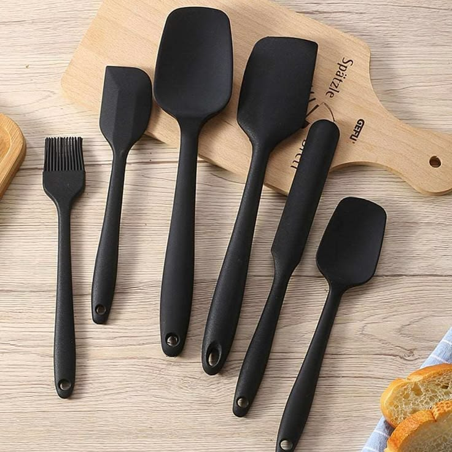
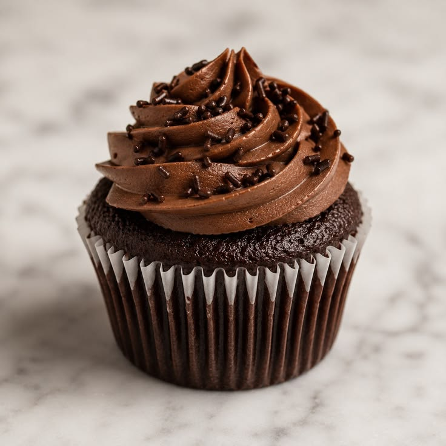

<!DOCTYPE html>
<html>
<head>
  <title>Continental Hotel Reservation Form</title>
  
</head>
<body>
  <h2>Continental Hotel Reservation Form</h2>

  <form>
    <table>
      <tr>
        <th>Name</th>
        <td><input type="text" placeholder="Enter your name"></td>
      </tr>
      <tr>
        <th>eMail</th>
        <td><input type="email" value="info@continental.pk"></td>
      </tr>
      <tr>
        <th>Mobile No</th>
        <td><input type="text" placeholder="Enter your cell number"></td>
      </tr>
      <tr>
        <th>Arrival Time</th>
        <td><input type="text" placeholder="Enter your arrival time"></td>
      </tr>
      <tr>
        <th>Departure</th>
        <td>
          <input type="text">
          <input type="text">
        </td>
      </tr>
      <tr>
        <th>Room Type</th>
        <td>
          <input type="radio" name="room">Single
          <input type="radio" name="room">Double 
          <input type="radio" name="room">Presidential Suite
        </td>
      </tr>
      <tr>
        <th>Preferences</th>
        <td>
          <input type="checkbox">Non-Smoking 
          <input type="checkbox">Internet 
          <input type="checkbox">Firm Mattress
        </td>
      </tr>
      <tr>
        <th>Mode of Payment</th>
        <td>
          <input type="checkbox">Cash
          <input type="checkbox">Check 
          <input type="checkbox">Credit Card
          <select>
            <option>Select Card</option>
          </select>
        </td>
      </tr>
      <tr>
        <td colspan="2" style="text-align:center">
          <input type="submit" value="Send Data">
        </td>
      </tr>
    </table>
  </form>

</body>
</html>

# task 4
<!DOCTYPE html>
<html>
<head>
  <title>Victoria Journal</title>
  
</head>
<body>
  

    

      <h1>Victoria's Journal</h1>
      
So fresh and so clean

    

    

      <h2>Friends</h2>
      <ul>
        <li>390 buddies</li>
        <li>Big Wall</li>
        <li>Conan The Librarian</li>
      </ul>
    

    

      

        <h3>04/09/08: Spatulas</h3>
        
        

          Yesterday, I went to the store and got some much needed spatulas!
          (what better way to say I love myself than to buy myself a spatula?)
        

      

      

        <h3>04/08/08: Cookie Cupcakes</h3>
        
        

          My favourite cartoon character is cookie, and my favourite dessert is
          cupcakes, so cookie cupcakes are best of both the worlds. Did you know?
          Cookie character once said, "Sometimes me think what is love, and then
          me think love is what cookie is for. Me give up the last cookie for
          you." I wonder if the same applies for the cupcakes?
        

      

    

  

</body>
</html>
